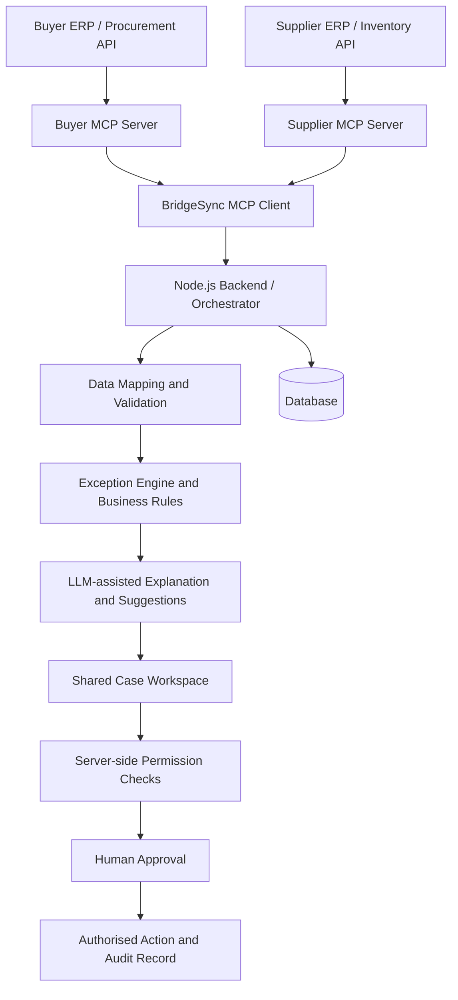

# Proposed Architecture

## High-level view

## Components

- **Partner systems:** Each organisation's authorised ERP or business APIs.
- **MCP servers:** Expose selected partner capabilities as MCP tools. Each partner controls what is exposed.
- **MCP clients:** Connect to the partner servers, discover tools and invoke them.
- **Backend/orchestrator:** Coordinates tool calls, application logic and workflow state.
- **Data mapping and validation:** Converts partner-specific fields into a common application representation and checks data quality.
- **Exception engine:** Applies deterministic rules to compare requirements and commitments.
- **AI-assisted analysis:** Explains exceptions and proposes options based on retrieved information.
- **Shared case workspace:** Presents evidence, partner responses, decisions and status.
- **Security and approvals:** Enforces permissions and human approval before consequential actions.
- **Database:** Stores synthetic records, cases, decisions and audit events in the prototype.

## MCP interaction

1. An MCP client connects to an authorised MCP server.
2. The client requests the available tools (`tools/list`).
3. The application selects a relevant tool.
4. The client invokes it (`tools/call`).
5. The server returns the tool result.
6. BridgeSync validates and maps the result before using it.

MCP standardises how the application discovers and invokes tools. It does not itself provide partner authorisation, data mapping, business rules or a shared workflow; those are application and deployment responsibilities.

## Prototype boundary

The initial demonstration should use synthetic buyer and supplier systems. It should not be represented as a live connection to Toyota, BMW, SAP, Oracle or any other real enterprise system unless such a connection has been authorised and tested.
